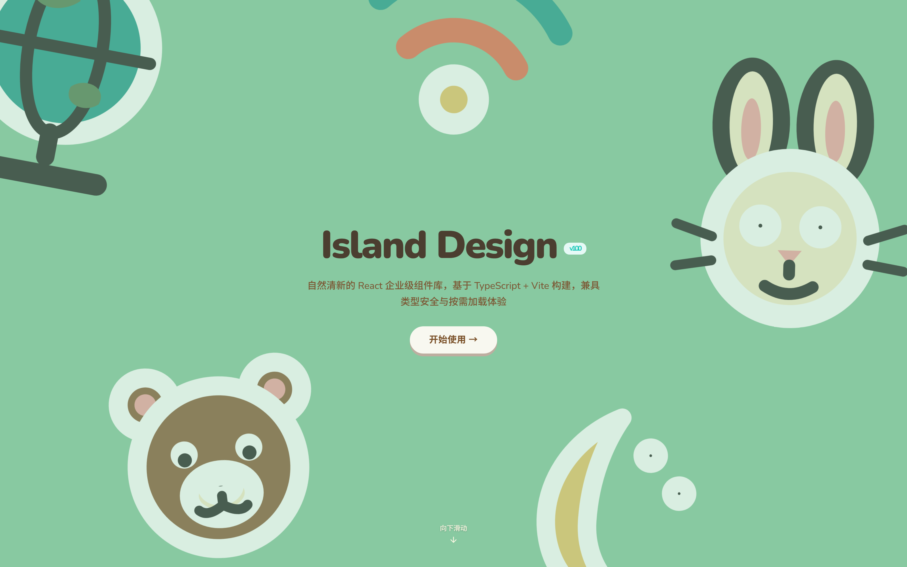
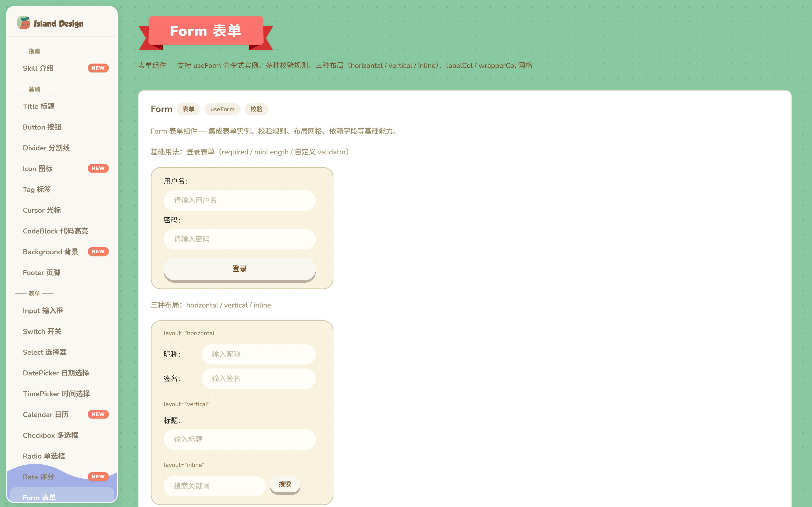
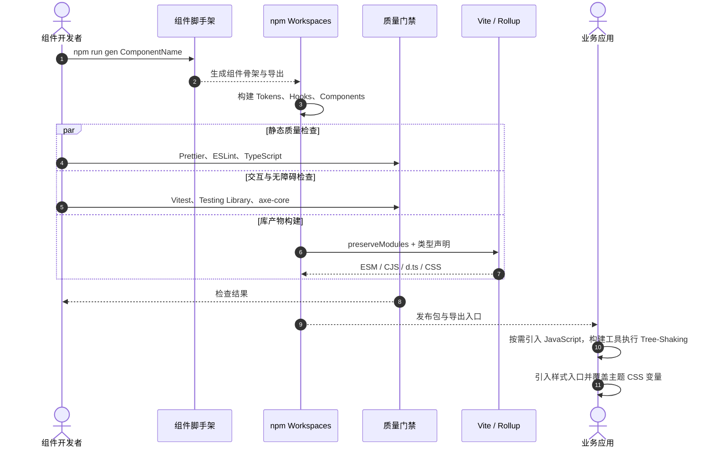

<div align="center">
  <h2>Island Design</h2>
  <p>
    <a href="https://github.com/snowcattail/island-design/stargazers"></a>
    
    
    
    
    
    
    <a href="./LICENSE"></a>
  </p>
  <p>面向现代 Web 应用的 <strong>基于 npm Workspaces 的 React 组件库与研发体系</strong>。</p>
  <p>将设计变量、通用状态逻辑与 42 个 UI 组件分层维护，解决跨项目复用、构建边界、复杂交互与主题一致性问题。</p>
  <p><a href="https://star-history.dera.page/#snowcattail/island-design&amp;Date"></a></p>
</div>

## 项目预览

**首页与主题表现**



**表单交互演练场**



业务开发者可以按职责使用 `@island-design/tokens` 的主题变量、`@island-design/hooks` 的通用逻辑和 `island-design` 的组件与类型声明。组件库保留 ESM 模块结构，支持消费端构建工具对未引用的 JavaScript 执行 Tree-Shaking；运行时可覆盖 `--island-*` CSS 变量调整主题。完整组件样式通过 `island-design/style` 引入，其体积不随 JavaScript Tree-Shaking 自动缩减。

## 核心功能

企业级前端基础设施常遇到**多包职责耦合、全量打包体积失控、表单与浮层状态复杂、协作规范与无障碍基线缺失**四类问题。Island Design 从以下四层组织工程能力。

### 📦 多包分层与按需构建

> 将设计变量、复用逻辑、组件与演练场分开维护，让业务端能够明确选择入口和构建范围。

- **多包职责解耦** — npm Workspaces 管理主题变量包、通用 Hooks 包、42 个组件的 UI 包与独立演练场；根构建命令按依赖顺序构建三个可复用包。
- **模块保留构建** — Vite 基于 Rollup 的库构建为组件输出 ESM 与 CJS，并保留模块目录；类型声明单独生成，消费端可以沿明确的导出边界解析组件。
- **明确副作用边界** — React 与 React DOM 作为 peer dependencies；`exports` 提供主入口、ES 子路径和样式入口，`sideEffects` 标记样式文件，帮助消费端对 JavaScript 进行 Tree-Shaking。组件样式另提供聚合 CSS 入口，需要显式引入。

```text
[npm Workspaces | TypeScript 5.7 | Vite 7]
Packages   @island-design/tokens -> @island-design/hooks -> island-design (42 components)
Demo       @island-design/demo
Outputs    packages/components/dist/es/* | dist/cjs/* | dist/types/* | dist/index.css
Contract   React / React DOM peerDependencies: >=18; styles marked as side effects
Quality    901 unit test cases in source + separate axe-core accessibility suite
```

### 🧩 复杂交互与状态管理

> 将字段更新、双模式状态与跨层浮层行为封装在组件内部，降低业务页面重复实现的成本。

- **字段订阅引擎** — `Form.useForm` 与 `Form.Item` 共享字段存储、字段级通知和异步规则校验；字段更新可以通知对应订阅者，减少无关字段重渲染。
- **双模式状态统一** — `useControllableState` 处理受控值、默认值与变更回调，为多种输入和交互组件提供一致的状态模型。
- **浮层焦点闭环** — `Modal`、`Drawer` 等使用 Portal、背景滚动锁定和焦点管理；关闭后可恢复先前焦点，减少键盘操作中断。
- **上传与键盘交互** — `Upload` 支持拖拽、上传前处理、自定义请求及 XHR 进度；`Select` 支持检索和键盘导航。

### 🎨 设计变量与动态主题

> 编译期隔离组件类名，运行时通过 CSS 自定义属性调整视觉主题。

- **变量分层管理** — Less 源变量集中定义色彩、间距、圆角、阴影与动效，并编译为 `--island-*` CSS 自定义属性，供组件样式消费。
- **作用域样式隔离** — Less Modules 使用 `island-[local]-[hash]` 类名，降低业务样式冲突；覆盖 CSS 自定义属性即可在运行时调整品牌色与相关主题值，无需重新编译组件库。主题切换行为由应用层控制。

### 🛠️ 研发脚手架与质量门禁

> 把组件骨架、静态检查、交互测试和无障碍检查纳入可重复执行的命令。

- **组件模板生成** — `npm run gen` 检查 PascalCase 命名与现有组件冲突，生成 Props、Less Module、导出入口及含 axe-core 断言的单测骨架；演练场和设计文档仍需按仓库规范补充。
- **测试与无障碍** — Vitest 与 Testing Library 覆盖 901 个源码单测用例，独立的 axe-core 套件检查核心组件典型用法；这提供自动化基线，不等于完整人工无障碍审计。
- **双版本质量矩阵** — GitHub Actions 在 Node 20/22 和 React 18/19 组合下执行测试与类型检查，并运行格式、文档同步、Lint、构建、包体与声明产物校验。

## 系统流程



## 技术栈

| 层次                | 技术与实现                                                            | 工程作用                               |
| ------------------- | --------------------------------------------------------------------- | -------------------------------------- |
| 核心框架与类型      | React 18 开发依赖；peer 范围 `>=18`；TypeScript 5.7                   | 类型化组件 API 与 React 18/19 消费兼容 |
| Monorepo 与构建链路 | npm Workspaces、Vite 7、Rollup、声明文件构建                          | 分包维护，输出 ESM/CJS 与类型声明      |
| 样式与主题体系      | Less Modules、CSS Custom Properties、Design Tokens                    | 组件类名隔离与运行时主题覆盖           |
| 交互演练与文档      | Vite 演练场、英文设计文档与中文镜像                                   | 展示组件用法和设计约束                 |
| 测试与工程门禁      | Vitest 4、Testing Library、axe-core、ESLint、Prettier、GitHub Actions | 回归测试、无障碍烟测及产物契约校验     |

架构选型围绕分包职责和可消费产物展开：Tokens 编译样式变量，Hooks 输出复用逻辑，组件包保留模块结构，演练场独立构建。按需 JavaScript 与聚合 CSS 是两个不同的消费边界。

## 组件矩阵

| 分类           | 组件与职责                                                                                                                                      |
| -------------- | ----------------------------------------------------------------------------------------------------------------------------------------------- |
| 基础与排版     | `Button` 操作按钮；`Title` 标题；`Divider` 分隔；`Tag` 状态标签；`Avatar` 用户头像；`Badge` 数量或状态标记；`CodeBlock` 代码展示；`Footer` 页脚 |
| 输入与表单     | `Input` 文本输入；`Select` 选项检索；`Checkbox` 多选；`Radio` 单选；`Switch` 开关；`Rate` 评分；`Form` 字段管理与校验；`Upload` 文件上传        |
| 日期与时间     | `DatePicker` 日期选择；`TimePicker` 时间选择；`Calendar` 日历与日程；`Time` 时间展示；`Countdown` 倒计时；`CountUp` 数值递增                    |
| 反馈与浮层     | `Modal` 模态对话框；`Drawer` 抽屉；`Notification` 通知；`Tooltip` 提示；`Loading` 加载；`Progress` 进度；`Skeleton` 骨架占位；`NoData` 空状态   |
| 数据展示与导航 | `Card` 内容容器；`Collapse` 折叠内容；`Table` 表格；`Tabs` 标签页；`Pagination` 分页；`Chart` 图表；`Carousel` 轮播；`Image` 图片预览           |
| 视觉与辅助     | `Background` 背景装饰；`Cursor` 光标效果；`Typewriter` 打字效果；`BackTop` 返回顶部                                                             |

## 本地运行

### 环境要求

| 工具    | 要求                                            |
| ------- | ----------------------------------------------- |
| Node.js | `>=18`；CI 使用 20 与 22                        |
| npm     | 支持 Workspaces；使用仓库的 `package-lock.json` |

```bash
node --version
npm --version
```

### 1. 安装依赖与启动演练场

```bash
npm install
npm run dev
```

### 2. 使用 CLI 脚手架创建新组件

```bash
npm run gen Badge -- --dry-run
npm run gen <ComponentName>
```

`Badge` 已存在，预览命令会报告命名冲突；实际创建时请换成新的 PascalCase 名称，并补齐演练场与设计文档。

### 3. 构建多包产物与演示站点

```bash
npm run build
npm run build:demo
```

### 4. 运行质量门禁与无障碍测试

```bash
npm run format:check
npm run lint
npm run typecheck
npm run test:run
npm run test:a11y
npm run check:types
npm run ci
```

## 目录结构

```text
island-design/
├── apps/demo/             # 交互演练场
├── packages/
│   ├── components/        # 42 个组件与库构建配置
│   ├── hooks/             # 复用状态与焦点逻辑
│   └── tokens/            # Less 变量与主题 CSS
├── scripts/               # 组件生成及产物校验
├── docs/                  # 设计系统与研发文档
└── .github/workflows/     # Node / React 质量矩阵
```

## License

本项目采用 [MIT License](./LICENSE)。
